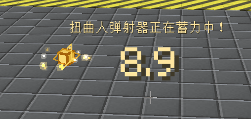

# GT-Funny-Idea

此版本客户端与服务端均需 [MIAOKATZE Core 0.1.4](https://github.com/MIAOKATZE/MIAOKATZE-Core)（兼容区间：0.1.4 ≤ 版本 < 0.2.0）。FalsePatternLib 可在缺失时补下载；已有旧版请手动更新。

**邪门想法 · GTNH 扭曲玩法扩展**

A lightweight Thaumcraft 4 addon for GTNH 2.9.0. Eject high-warp players, carry a portable ejector, and pass warp to other players.

一个为 GTNH 2.9.0 与神秘时代 4 制作的轻量模组，让扭曲多一些邪门的用途。

- **扭曲人弹射器**：放置后检测附近玩家的扭曲，倒计时结束后将其弹飞。右键调整设置，弹射路径带有光效。
- **便携扭曲人弹射器**：放在背包或 Baubles 吊坠槽中随身生效，并忽略持有者本人。右键设置，潜行右键开关。
- **扭曲转移器**：用法杖右击已放置的弹射器转换取得。瞄准附近玩家蓄力，将扭曲传给对方；使用后获得经验，逐渐解锁更多扭曲类型。潜行右键打开终端，Alt 加右键可积累临时扭曲。

[下载 / Releases](https://github.com/MIAOKATZE/GT-Funny-Idea/releases) · [模组主页](https://miaokatze.com/)

GTNH 2.9.0 RC2 is the only supported platform baseline. Older beta/RC1 packs are unsupported.
