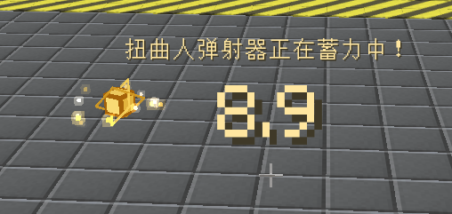

# GT-Funny-Idea

**邪门想法 · GTNH 扭曲玩法扩展**

A lightweight Thaumcraft 4 addon targeting GTNH 2.9.0. The current 0.1.2 source compiles against the final modpack dependencies: GT5U 5.09.54.265, ModularUI2 2.3.94, Thaumcraft 4.2.3.5 and Baubles Expanded 2.2.27. Eject high-warp players, carry a portable ejector, and pass warp to other players.

一个以 GTNH 2.9.0 与神秘时代 4 为目标的轻量模组，让扭曲多一些邪门的用途。当前0.1.2开发源码已对齐正式版编译依赖；构建与各类实机验收分别记录，不代表已有新发布版本。

- **扭曲人弹射器**：放置后检测附近玩家的扭曲，倒计时结束后将其弹飞。右键调整设置，弹射路径带有光效。
- **便携扭曲人弹射器**：放在背包或 Baubles 吊坠槽中随身生效，并忽略持有者本人。右键设置，潜行右键开关。
- **扭曲转移器**：用法杖右击已放置的弹射器转换取得。瞄准附近玩家蓄力，将扭曲传给对方；使用后获得经验，逐渐解锁更多扭曲类型。潜行右键打开终端，Alt 加右键可积累临时扭曲。

[下载 / Releases](https://github.com/MIAOKATZE/GT-Funny-Idea/releases) · [模组主页](https://miaokatze.com/)

## 开发入口

[项目约定](AGENTS.md)说明本仓现状、约束、验证和专项技能；跨项目开发宗旨、完整新技能和审阅入口统一在[开发基线校准](../开发基线校准/README.md)。

使用仓库wrapper执行 `./gradlew build --no-configuration-cache`。`check`包含纯规则、生产及实验室专服ABI、普通/测试运行包隔离与生产条目字节一致性核验。

主动测试源码位于 `src/testlab`，普通包不含实验室、测试命令或客户端冒烟驱动。完整 `*-testlab.jar` 是同modid替换包，不能与普通包并装；`*-testlab-dev.jar` 仅用于开发。测试配置默认关闭，启用方式、OP2控制权限及恢复要求见[原生测试指南](plan/测试维度指南.md)。本仓保持独立测试协议，无Core依赖，不冒称已接入四核心共享宿主。
